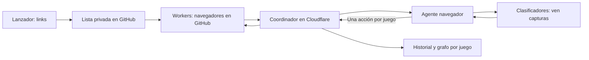

# Game Pilot MCP

Game Pilot permite que un agente navegue juegos demo, haga compras de funciones con saldo ficticio, complete sus bonus y registre cómo lo hizo. **Los juegos corren en GitHub Actions**; **Cloudflare** coordina las sesiones y guarda capturas, acciones y resultados. El lanzador de la PC sirve para enviar los links.

Repositorio: [Shisetsu-Code/game-pilot-mcp](https://github.com/Shisetsu-Code/game-pilot-mcp). Servidor MCP: **https://game-pilot-mcp.braian-n-l.workers.dev/mcp**.

Es un proyecto independiente de Hybrid Cloud Fuzzer y Cloud-Fuzzer. Tiene su propio MCP, colas, almacenamiento y credenciales. Los clasificadores deben trabajar con capturas de **Game Pilot**, sin consumir las colas de los otros fuzzers.

## Qué queremos conseguir

Enviar una lista de juegos y completar las compras disponibles de cada uno: free spins, bonus buy, antebet o equivalentes, además de tres tiradas normales. Dentro de un bonus hay que continuar, iniciar sus tiradas o elegir elementos cuando haga falta, hasta verificar su resultado final.

Queremos hacerlo en paralelo, con pocas esperas, imágenes comprimidas y aceleración compatible. Cada juego debe conservar un grafo BFS de caminos y un registro de capturas, coordenadas, clicks y resultados para revisar y repetir el recorrido. Si un proveedor presenta errores reales, se omite y se continúa con otros.

**Ese es el objetivo. Todavía no hay un servicio autónomo que garantice terminar todos los juegos o todos los proveedores sin intervención del agente.**

## Cómo funciona



El **agente navegador** controla las compras y comprueba resultados. Los **clasificadores** reciben imágenes y devuelven estados y coordenadas; no compran por su cuenta. Los **workers** ejecutan el mouse, scroll, arrastre o teclas permitidas. Un worker de navegador no es una instancia de GPT.

## Cómo usarlo: lanzador local, juegos remotos

Necesitás acceso al repositorio privado, Node.js **22.16 o superior**, GitHub CLI y una sesión con permiso para publicar listas y ejecutar Actions.

```powershell
gh repo clone Shisetsu-Code/game-pilot-mcp
cd game-pilot-mcp
npm ci
gh auth status
```

Si ya tenés una copia, usá esa carpeta. Si falta la sesión, ejecutá `gh auth login`.

1. Abrí **Abrir-Lanzador.cmd**. Alternativa: `node scripts/launcher.mjs` y **http://127.0.0.1:4188**.
2. Pegá **un link HTTPS de demo por línea**, hasta 64 por tanda, y confirmá el uso de saldo ficticio.
3. Elegí entre 1 y 300 minutos de ejecución. Dejá WireGuard desactivado para trabajar sin VPN.
4. Pulsá **Enviar y ejecutar en GitHub**. El formulario guarda `queues/UUID.json` y devuelve un enlace a Actions.
5. Conectá el agente al MCP de **Game Pilot**, autorizá esa conexión y pedile que procese la tanda mediante `list_runs`. Para hacerlo desde ChatGPT web, seguí [estos pasos](docs/client.md#chatgpt-web).

El formulario arranca navegadores; **no inicia por sí mismo la inferencia de un modelo**. Después del envío, podés cerrar el lanzador o apagar la PC: los juegos siguen en GitHub durante la ejecución. El agente que analiza capturas debe seguir activo para generar decisiones.

Si la lista se guardó pero Actions no arrancó, usá la ruta `queues/UUID.json` indicada para iniciar el workflow manualmente, sin duplicar el envío.

### Instrucción de ejemplo para el agente

> Usá exclusivamente Game Pilot MCP. Localizá mi tanda con list_runs. Navegá los juegos en paralelo y pasá sus capturas a los clasificadores. Hacé las compras visibles con saldo ficticio, completá cada bonus y tres tiradas normales. Entre rondas esperá inicialmente diez segundos y pedí una captura nueva. Usá Turbo nativo o aceleración efectiva comprobada cuando sea compatible. Guardá acciones y resultados. Si un proveedor da un error real, omitilo y seguí con otros. No repitas una compra de resultado incierto.

Ver [el ciclo de navegación y clasificación](docs/vision-loop.md) y [los contratos MCP](docs/client.md).

## Capacidad actual

| Modalidad | Navegadores | Capacidad |
| --- | --- | --- |
| Lanzador sin VPN | `distributed-browsers.yml`: cuatro máquinas de GitHub | Hasta 8 por worker: **32 juegos simultáneos** |
| Con WireGuard | `browsers.yml`: un job con cuatro procesos | 2 por worker por defecto: **8 juegos** |
| Supervisor local opcional | Cuatro procesos en la PC | 2 por worker por defecto; configuración de 1 a 8 |

La cola admite 64 links; no se abren todos a la vez. La admisión puede esperar si falta memoria. Distintas tandas pueden tener ejecuciones distintas: revisar Actions para conocer el consumo total.

**20 workers / 160 juegos no está implementado.** El límite de jobs de la cuenta de GitHub no aumenta automáticamente los cuatro workers de este proyecto. Las [mediciones de capacidad](docs/capacity-idle-evidence.json) y [saturación](docs/capacity-saturation-evidence.json) son sintéticas, no garantías para proveedores reales.

## Estado real

| Función | Estado |
| --- | --- |
| Lanzador, listas privadas y navegadores en GitHub | Implementado |
| MCP con OAuth, coordinación en Cloudflare y credenciales separadas | Implementado; cada cliente debe conectarse y autorizarse |
| Capturas JPEG por lotes, hasta 8 por llamada | Implementado; perfil habitual de calidad 45 y ancho máximo 960 |
| Mouse, scroll, arrastre y teclas permitidas | Implementado, con comprobaciones de geometría y objetivo |
| BFS por juego, cobertura y exportaciones | Implementado; depende de lo que el agente realmente recorra y verifique |
| Compras y bonus de cualquier proveedor | **Parcial**; todavía hay bloqueos, adaptaciones pendientes y resultados inciertos |
| Agente navega y chats clasifican | Flujo operativo. El clasificador interno pudo ver archivos; el envío probado a chats normales por URL y texto base64 falló |
| Aceleración universal x4 | **No implementada**; hay aceleración limitada y Turbo nativo según el juego |
| WireGuard desde el formulario | Implementado para perfiles compatibles; requiere servidor y perfil real. No hay servidor del usuario configurado |
| Inferencia autónoma permanente por API | Pendiente; este repositorio no la inicia ni la financia |

Una compra pulsada no equivale a un bonus terminado. `complete_game` comprueba las opciones registradas y tres tiradas verificadas; no descubre compras que el agente nunca vio. Las pruebas de infraestructura no certifican todo el catálogo.

## Esperas, velocidad y errores

Los **diez segundos son una espera inicial**. Después hay que pedir `request_observation`: la foto inmediata de un input puede seguir mostrando su animación inicial. Si la ronda continúa, se espera y se captura otra vez.

`set_game_speed` solicita 1x, 2x o 4x; sólo aplica a animaciones Web Animations compatibles y necesita rondas verificadas. No acelera necesariamente canvas, red ni análisis del modelo. Turbo Spin nativo es otra opción, pero no equivale automáticamente a x4.

Un error real del documento del juego, como 404/403, se registra y puede justificar omitir su proveedor. Una carga lenta, un timeout de captura o el 404 de un recurso accesorio no prueban que el juego sea inválido. Si una compra pudo haberse ejecutado, se conserva su evidencia y se reconcilia antes de repetir inputs financieros.

## WireGuard opcional

Hace falta un servidor/proveedor WireGuard y un perfil de cliente `.conf`. Subir el archivo en el formulario **no crea un servidor VPN**. Para operar sin VPN, dejar la opción desactivada.

El perfil se guarda como secreto de GitHub; la lista contiene sólo su referencia. El workflow valida el túnel antes de abrir juegos. La conexión real del perfil del usuario todavía debe probarse. Ver [Operación](docs/operations.md#wireguard-desde-el-lanzador).

## Historial y reproducción

`get_game_graph` muestra los caminos por juego. `export_replay` guarda manifiesto JSON y eventos JSONL con estados, inputs, resultados e imágenes referenciadas. D1 y el bucket privado R2 conservan los datos remotos.

`start_replay` y `advance_replay` repiten pasos verificados comprobando pantallas y objetivos. Se registra el recorrido; **los premios aleatorios no son reproducibles**. Un cambio de pantalla puede exigir una decisión nueva.

## Guías y desarrollo

- [Operación y despliegue](docs/operations.md): Cloudflare, secretos, workflows, parada y recuperación.
- [Cliente MCP](docs/client.md): observaciones, coordenadas, herramientas y compras pendientes.
- [Navegación y clasificación](docs/vision-loop.md): reparto de funciones, esperas y entrega de capturas.
- [Diseño](docs/design.md) y [plan inicial](docs/implementation-plan.md): contexto del desarrollo; no sustituyen el estado actual de este README.

Para ejecutar también los navegadores en la PC, de forma opcional:

```powershell
npm ci
npx playwright install chromium
node scripts/init-local.mjs
.\Start-Game-Pilot.ps1
```

Para comprobar el código:

```powershell
npm run check
npm test
npm run test:browser
```

GitHub Actions consume minutos y Cloudflare consume sus recursos según el uso. El código actual no incorpora inferencia autónoma por API de OpenAI; una futura integración necesitaría su propia configuración y presupuesto. No subir `.env`, `data`, perfiles VPN ni claves al repositorio.
